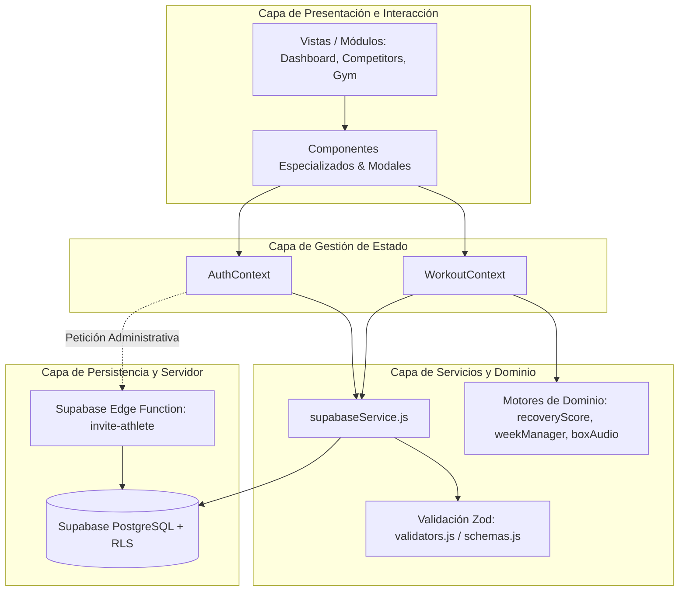

# Arquitectura Técnica del Sistema — Hift Iron Box App

> **Documento de Arquitectura y Especificación de Diseño de Software**  
> **Versión:** 2.0.0 — Octubre 2026  
> **Audiencia:** Desarrolladores de software, arquitectos técnicos, ingenieros DevOps y auditores de seguridad.

---

## 1. Visión General del Proyecto

### 1.1. Propósito y Dominio
**Hift Iron Box App** es una plataforma web progresiva (PWA / Mobile-First SPA) orientada a la **gestión, periodización y ejecución de entrenamientos de CrossFit de alta competición y fitness tradicional** para atletas y entrenadores de boxes. 

El sistema resuelve la complejidad del entrenamiento híbrido en centros de alto rendimiento mediante dos módulos o "zonas" claramente diferenciadas:
1. **Competitors Hub (HIFT Competitors):** Programación avanzada de CrossFit dividida en bloques técnicos diarios (*Warm-up, Weightlifting, Gymnastics, Metcon, Accessory*), con cronómetros especializados integrados, registro de marcas personales (PRs), marcadores de rendimiento y un algoritmo predictivo de preparación biológica (*Iron Program Daily Readiness*).
2. **Traditional Gym (Musculación & Hipertrofia):** Catálogo de rutinas estructurado por grupos musculares y sesiones personalizadas asignadas directamente por el Head Coach.

La aplicación incluye un **Panel de Control para Entrenadores (Admin Panel)** con importación automatizada de rutinas desde documentos de Microsoft Word (`.docx`), asignación de macro/microciclos semanales a atletas específicos o a nivel de box general, y un sistema de invitaciones seguras con aprovisionamiento automático de cuentas vía Edge Functions.

### 1.2. Stack Tecnológico

| Capa | Tecnología | Justificación y Rol |
| :--- | :--- | :--- |
| **Frontend Framework** | **React 19** (`react`, `react-dom`) | Arquitectura basada en componentes reactivos, Hooks modernos (`useCallback`, `useMemo`, `useState`), manipulación eficiente del DOM y soporte concurrente. |
| **Build Tool & Bundler** | **Vite 8** (`@vitejs/plugin-react`) | Tiempos de inicio y Hot Module Replacement (HMR) casi instantáneos, empaquetado optimizado con Rollup y soporte nativo para ES Modules. |
| **Estilos & UI** | **Vanilla CSS Moderno** (`index.css`, `App.css`) | Variables CSS (Design Tokens HSL), estética Dark Mode Cyberpunk/Neon de alto contraste, Glassmorphism, animaciones aceleradas por GPU sin sobrecarga de dependencias adicionales (evitando ataduras a frameworks pesados). |
| **Linter & Code Quality** | **Oxlint** (`oxc`) | Análisis estático de código ultrarrápido basado en Rust para garantizar conformidad de sintaxis y buenas prácticas. |
| **Backend & Base de Datos** | **Supabase (PostgreSQL 15+)** | Arquitectura *Backend-as-a-Service* (BaaS). Almacenamiento relacional, extensiones (`uuid-ossp`), tipado estricto, triggers PL/pgSQL y políticas de seguridad a nivel de fila (*Row Level Security* - RLS). |
| **Autenticación** | **Supabase Auth** | Autenticación criptográfica mediante tokens JWT estándar (Bearer Token), sesiones persistentes (`persistSession`), flujos de invitación por email y recuperación de contraseñas. |
| **Serverless Backend** | **Supabase Edge Functions (Deno + TypeScript)** | Microservicios de backend aislados para operaciones administrativas privilegiadas que requieren `service_role` (ej. creación de cuentas de atletas sin exponer claves maestras al cliente). |
| **Validación de Datos** | **Zod v4** (`zod`) | Validación estricta y sanitización de payloads tanto en el cliente como en Edge Functions antes de impactar la base de datos. |
| **Audio Síntesis** | **Web Audio API** (`src/utils/boxAudio.js`) | Generador procedural de tonos audibles de intervalos (cuenta atrás 3-2-1, cambios de round y bleep de finalización) sin depender de archivos de audio externos. |
| **Procesamiento de Archivos**| **Mammoth.js** & **PDF.js** | Ingesta semántica y parsing en memoria de documentos `.docx` y `.pdf` para digitalizar planificaciones complejas de entrenadores. |
| **Hosting & Entrega** | **Vercel** (`vercel.json`) | Servidor Edge global con rewrite a SPA, cabeceras HTTP de seguridad reforzada (CSP estricto, HSTS, X-Frame-Options, Permissions-Policy). |

---

## 2. Mapa de Estructura de Carpetas (Árbol)

A continuación se detalla la jerarquía completa del repositorio:

```text
hift-iron-box-app/
├── .env.example                     # Plantilla de variables de entorno (VITE_SUPABASE_URL, etc.)
├── .oxlintrc.json                   # Configuración del linter estático Oxlint
├── ARCHITECTURE.md                  # Especificación técnica y arquitectónica del sistema
├── Especificacion_Recuperacion_...  # Especificación funcional del algoritmo Iron Program
├── index.html                       # Entry point HTML de la aplicación SPA
├── package.json                     # Manifiesto de dependencias, scripts y metadatos del proyecto
├── README.md                        # Documentación básica de arranque
├── supabase_schema.sql              # Script SQL idempotente: tablas, triggers, RLS y funciones
├── vercel.json                      # Configuración de despliegue en Vercel y Security Headers
├── vite.config.js                   # Configuración del entorno de desarrollo y build de Vite
│
├── public/                          # Recursos estáticos servidos directamente
│   └── favicon.ico
│
├── supabase/                        # Infraestructura como código de Supabase
│   └── functions/                   # Deno Edge Functions
│       └── invite-athlete/          # Endpoint para invitar y aprovisionar atletas
│           └── index.ts
│
└── src/                             # Código fuente del Frontend
    ├── main.jsx                     # Punto de entrada de React (montaje en #root)
    ├── App.jsx                      # Orquestador raíz de vistas, layouts y modales
    ├── App.css                      # Estilos de maquetación móvil y estructura general
    ├── index.css                    # Design Tokens, variables CSS, utilidades y reset
    │
    ├── assets/                      # Identidad gráfica (logos SVG, fondos, hero banners)
    │
    ├── components/                  # Componentes de UI modulares y especializados
    │   ├── admin/                   # Herramientas exclusivas del Head Coach
    │   ├── athlete/                 # Vistas interactivas de entrenamientos y marcas
    │   ├── auth/                    # Pantallas de autenticación y cambio de credenciales
    │   ├── calculator/              # Calculadora de 1RM y distribución de discos en barra
    │   ├── common/                  # Componentes reutilizables atómicos (ej. BrandLogo)
    │   ├── competitors/             # Componentes adaptativos y barreras de Readiness
    │   ├── gym/                     # Selectores de grupos musculares para fitness
    │   ├── layout/                  # Estructura visual global (Header, BottomNav)
    │   ├── privacy/                 # Modales de ejercicio de derechos RGPD y consentimientos
    │   ├── readiness/               # Banners y formularios de check-in de recuperación diaria
    │   ├── shared/                  # Componentes transversales (calendario, pasarelas de zona)
    │   ├── social/                  # Generador de historias para Instagram Canvas
    │   └── timer/                   # Cronómetro profesional de Box (EMOM, AMRAP, Tabata)
    │
    ├── context/                     # Capa de Estado Global (React Context API)
    │   ├── AuthContext.jsx          # Sesión, perfil de atleta, roles y consentimientos
    │   └── WorkoutContext.jsx       # Rutinas, plan semanal, PRs, logs y cronómetro
    │
    ├── data/                        # Conjunto de datos semilla (Fallbacks de inicio)
    │   └── initialWorkouts.js       # Catálogo inicial de WODs, PRs y ejercicios de muestra
    │
    ├── lib/                         # Clientes y singletons externos
    │   └── supabase.js              # Inicialización y validación del cliente `@supabase/supabase-js`
    │
    ├── modules/                     # Vistas funcionales principales (Screens de navegación)
    │   ├── competitors/             # Pantalla principal del Competitors Hub
    │   ├── dashboard/               # Selector de zona de entrenamiento y métricas
    │   └── traditional/             # Pantalla de entrenamiento de gimnasio tradicional
    │
    ├── services/                    # Capa de Acceso a Datos (Data Access Layer)
    │   └── supabaseService.js       # CRUD tipado y abstracción de queries a Supabase
    │
    └── utils/                       # Lógica de dominio pura, parsers y utilidades
        ├── boxAudio.js              # Síntesis Web Audio API para señales acústicas
        ├── documentParser.js        # Parser de programaciones desde archivos Word (.docx)
        ├── pdfParser.js             # Extractor de texto de documentos PDF
        ├── recoveryScore.js         # Algoritmo de ponderación y prescripción Iron Program
        ├── schemas.js               # Esquemas de validación Zod de base de datos
        ├── validators.js            # Validadores defensivos, formateadores y Safe Logger
        └── weekManager.js           # Cálculo de semanas ISO 8601 y formatos de fecha
```

---

## 3. Desglose Exhaustivo por Carpeta

### 3.1. `src/modules/` — Vistas de Alto Nivel (Screen Level Views)
* **Responsabilidad:** Representan las pantallas centrales o "páginas" dentro de la SPA móvil. Cada módulo orquesta componentes más pequeños y consume los contextos para pintar el estado del flujo seleccionado.
* **Archivos clave:**
  - `modules/dashboard/ZoneSelectorDashboard.jsx`: El "hub" neurálgico donde el usuario entra tras autenticarse. Permite alternar entre la zona Competitors y la zona Tradicional, visualiza el semáforo de recuperación diaria y muestra estadísticas rápidas del atleta.
  - `modules/competitors/CompetitorsView.jsx`: La vista para atletas de alto rendimiento. Conecta la programación del día (dividida en bloques A, B, C, etc.), el calendario de semanas y la barrera obligatoria de check-in (*Readiness Gate*).
  - `modules/traditional/TraditionalGymView.jsx`: La vista de musculación convencional. Permite navegar por grupos musculares (Pecho, Espalda, Piernas, etc.) o consultar el plan prescrito por el entrenador.
* **Tipo de lógica:** Presentación, orquestación de subcomponentes y manejo de eventos de navegación interna. No realiza consultas directas a Supabase (delega en los contextos).

### 3.2. `src/components/` — Componentes Especializados
Organizados por dominio de funcionalidad para favorecer la alta cohesión y el bajo acoplamiento:

* **`components/admin/` (Panel de Control del Entrenador):**
  - `AdminPanel.jsx`: Tablero con pestañas para programación general, asignación a atletas específicos y visualización.
  - `AthletePlanManager.jsx`: Matriz de asignación semana a semana de WODs a alumnos individuales.
  - `InviteAthleteModal.jsx`: Formulario que dispara la llamada a la Edge Function para invitar atletas por correo.
  - `WordImporter.jsx`: Herramienta de productividad que interpreta la programación redactada en Word y la traduce a objetos JSON normalizados compatibles con el catálogo de `workouts`.
  - `SupabaseSyncModal.jsx`: Modal de sincronización manual y prueba de conectividad con la base de datos remota.
* **`components/athlete/` (Interacción del Deportista):**
  - `RoutineDetail.jsx`: Renderiza la rutina seleccionada bloque a bloque. Permite marcar ejercicios completados en tiempo real, lanzar el cronómetro precargado con los tiempos de la rutina y registrar el resultado de rendimiento.
  - `PRTracker.jsx`: Tarjetas de récords personales (1RM de Clean & Jerk, Snatch, Back Squat, etc.) con histórico de fechas y cálculo de porcentajes.
  - `RoutineCard.jsx`: Tarjeta resumen de presentación de rutinas en listas.
  - `CompleteProfileModal.jsx`: Modal de onboarding para nuevos atletas invitados donde completan sus datos iniciales (experiencia, lesiones, foco).
* **`components/competitors/` & `components/readiness/` (Lógica de Salud y Adaptación):**
  - `CompetitorReadinessGate.jsx` & `ReadinessBanner.jsx`: Sistema de seguridad que evalúa si el atleta ya completó su cuestionario matutino de fatiga/sueño antes de permitirle entrenar.
  - `CompetitorAdaptationCard.jsx`: Si el score de recuperación del atleta cae en estado "Limitado" o "Baja", esta tarjeta calcula y presenta automáticamente las adaptaciones de carga (ej. reducir peso al 70%, suprimir fallos musculares, recortar volumen).
  - `ReadinessCheckinModal.jsx`: Formulario visual para registrar las métricas biométricas subjetivas (sueño, estrés, fatiga muscular, dolor).
* **`components/timer/` & `src/utils/boxAudio.js` (Cronómetro de Box):**
  - `BoxTimer.jsx`: Temporizador digital multifunción (Stopwatch, For Time, AMRAP, EMOM e Intervalos).
  - *Decisión arquitectónica clave:* El cronómetro permanece montado en `App.jsx` ocultándose mediante `display: none` cuando se cambian de pestañas, lo que evita que un atleta pierda la cuenta del tiempo si navega a consultar la rutina o registrar una marca.
* **`components/calculator/` (Herramientas de Pista):**
  - `PercentageCalculatorModal.jsx`: Calculadora de porcentajes instantánea basada en el 1RM registrado, incluyendo despiece gráfico de discos en barra olímpica masculina (20 kg) o femenina (15 kg).
* **`components/privacy/` (Cumplimiento Legal y RGPD):**
  - `PrivacyAndDataModal.jsx`: Provee cumplimiento estricto con el RGPD y la LOPDGDD española (consentimiento granular explícito para datos de salud, descarga de todos los datos en formato JSON, y solicitud de derecho al olvido / borrado de cuenta).

### 3.3. `src/context/` — Estado Global y Casos de Uso
* **Responsabilidad:** Actúa como el puente reactivo entre la interfaz de usuario y la capa de servicios. Centraliza la reactividad y las transiciones de estado de toda la aplicación.
* **`AuthContext.jsx`:**
  - Gestiona el ciclo de vida de la sesión de Supabase Auth (`onAuthStateChange`).
  - Almacena el perfil del usuario autenticado (`currentUser`) y determina el rol estricto (`isAdmin` vs `athlete`).
  - Implementa la funcionalidad de **Coach Impersonation** (`isImpersonatingAthlete`), permitiendo al entrenador visualizar la app con los permisos y rutinas exactas de cualquiera de sus alumnos sin cerrar su sesión de coach.
  - Maneja los consentimientos RGPD en memoria y sincronizados con base de datos.
* **`WorkoutContext.jsx`:**
  - Mantiene el catálogo de rutinas activas (`workouts`), el plan del box (`boxWeeklySchedule`) y los planes individuales (`weeklyAthletePlans`).
  - Registra las marcas de PRs (`prs`), logs de rendimiento (`performanceLogs`) y los ejercicios marcados como completados (`completedExercises`).
  - Contiene los manejadores de apertura/cierre de modales globales (calculadora, story modal, check-in).

### 3.4. `src/services/` — Capa de Abstracción de Datos (DAL)
* **Responsabilidad:** Aislar al resto de la aplicación de los detalles de implementación de la API o la base de datos. Si la estructura de una tabla cambia o se migra de backend, solo se modifica este archivo.
* **`supabaseService.js`:**
  - Métodos asíncronos para todas las operaciones (`fetchWorkoutsFromSupabase`, `upsertWorkoutInSupabase`, `saveWeeklyPlanInSupabase`, etc.).
  - Integra validación previa de payloads usando los métodos de `src/utils/validators.js` antes de despachar las queries a Supabase.
  - Realiza la conversión bidireccional entre la nomenclatura snake_case de PostgreSQL (ej. `muscle_group`, `day_id`) y el camelCase de JavaScript (ej. `muscleGroup`, `dayId`).
  - Manejo seguro de errores con captura de excepciones para que fallos de red no rompan el árbol de React.

### 3.5. `src/lib/` — Integración con Librerías de Terceros
* **`supabase.js`:** 
  - Inicializa la instancia Singleton de `@supabase/supabase-js`.
  - Lee las variables de entorno `VITE_SUPABASE_URL` y `VITE_SUPABASE_ANON_KEY`.
  - Detecta flujos especiales en la URL en el arranque (ej. `hashParams.get('type') === 'recovery'`) antes de que el router o el cliente Supabase limpie la barra de direcciones.

### 3.6. `src/utils/` — Motores de Cálculo y Lógica de Negocio Pura
* **`recoveryScore.js`:** Implementación pura y sin efectos secundarios de la especificación técnica **Iron Program**.
  - Ponderación matemática: `PRS * 0.40 + Sueño * 0.20 + Fatiga * 0.20 + Energía * 0.10 + Estrés * 0.10`.
  - Normalización sobre escala 0 a 10.
  - Detección de banderas rojas (dolor articular/muscular) que reclasifica el estado automáticamente a niveles de alerta y redacta sugerencias fisiológicas de adaptación del entrenamiento.
* **`documentParser.js`:** Algoritmo que procesa el HTML/texto plano generado por Mammoth desde archivos `.docx`, detecta encabezados de días, secciones de halterofilia, metcons y accesorios, generando estructuras de datos normalizadas listas para base de datos.
* **`validators.js` & `schemas.js`:** Reglas defensivas de validación mediante esquemas Zod (validación de UUIDs, strings requeridos, rangos numéricos) y `safeLogger` para evitar imprimir tokens o PII sensible en consolas de producción.
* **`weekManager.js`:** Manejo determinista de semanas ISO: calcula la clave de semana a partir del lunes correspondiente (`YYYY-MM-DD`), facilitando la navegación temporal sin desfases horarios por zonas horarias.

### 3.7. `supabase/` — Código del Servidor y Base de Datos
* **`supabase_schema.sql`:** Definición DDL idempotente de 11 tablas relacionales, índices, triggers de protección de roles (evita que un atleta pueda elevar sus propios privilegios a admin mediante peticiones directas a la API) y políticas RLS exhaustivas.
* **`supabase/functions/invite-athlete/index.ts`:**
  - Microservicio serverless Deno.
  - Valida el token del Head Coach llamante.
  - Aplica políticas de CORS restrictivas (whitelist de dominios).
  - Usa la `SUPABASE_SERVICE_ROLE_KEY` en el entorno seguro del servidor para crear el usuario en `auth.users` y enviar el email oficial de invitación con contraseña temporal / enlace mágico de registro.

---

## 4. Flujo de Datos y Conexiones Clave

### 4.1. Arquitectura en Capas
La aplicación sigue un flujo unidireccional y desacoplado, estructurado en 4 capas concéntricas:



### 4.2. Flujo de Autenticación y Autorización (RBAC)
1. **Inicio de Sesión:** El atleta o entrenador ingresa sus credenciales en `LoginScreen.jsx`.
2. **Emisión de Tokens:** Supabase Auth autentica contra `auth.users` y emite un JWT firmado que contiene el `sub` (User UUID) y `app_metadata` (rol y zonas de acceso permitidas).
3. **Sincronización de Perfil:** `AuthContext` escucha el evento `SIGNED_IN`, toma la sesión y consulta la tabla `public.athletes` mediante `fetchAthleteProfile` para obtener metadatos específicos del box.
4. **Protección de Rutas y Funciones:**
   - En el frontend: la UI conmuta entre la vista de entrenador (`AdminPanel`) y la de atleta (`ZoneSelectorDashboard`), restringiendo el acceso a herramientas administrativas.
   - En el backend: el trigger de PostgreSQL `tr_protect_athlete_role` rechaza cualquier intento de un usuario no autorizado de modificar su rol a `admin` en la base de datos.

### 4.3. Flujo de Carga y Asignación de Entrenamientos
1. **Planificación:** El entrenador importa un Word (`WordImporter`) o redacta un WOD (`CreateRoutineModal`).
2. **Persistencia de Catálogo:** Se guarda en la tabla `workouts`.
3. **Asignación:** El coach decide si el WOD se publica en el calendario general del box (`box_weekly_schedules`) o como prescripción personalizada para un atleta concreto (`weekly_athlete_plans`).
4. **Lectura por el Atleta:** Al ingresar en `CompetitorsView`, el sistema consulta en `WorkoutContext` si el atleta tiene un plan individual para ese día; si no lo tiene, recurre por cascada a la programación general del box para esa semana (`selectedWeek`).

### 4.4. Flujo del Algoritmo de Recuperación (Iron Program)
1. **Check-in:** El atleta completa el test diario (sueño, fatiga, estrés, energía, PRS y dolor opcional).
2. **Cálculo Determinista:** `recoveryScore.js` calcula el score numérico (0 - 10) y clasifica en 4 categorías:
   - **Óptimo (8.0 - 10):** Carga 100%, intensidad completa.
   - **Adecuado (6.5 - 7.9):** Carga habitual, autorregulación de RPE.
   - **Limitado (5.0 - 6.4):** Reducción de intensidades al 80-85%, recorte de volumen accesorio.
   - **Baja (< 5.0 o presencia de dolor agudo):** Trabajo regenerativo, movilidad o suspensión de ejercicios lesivos.
3. **Persistencia Segura:** Se envía a la tabla `readiness_logs` (clasificada como dato de salud protegido por RGPD).
4. **Adaptación en Tiempo Real:** `CompetitorAdaptationCard` ajusta los pesos sugeridos en la pantalla de la rutina antes de iniciar la sesión.

### 4.5. Modelo de Seguridad y Row Level Security (RLS)
Todas las operaciones directas a Supabase utilizan la clave pública `anon-key` y viajan acompañadas del JWT del usuario en la cabecera `Authorization: Bearer <TOKEN>`. La seguridad nunca recae en el cliente:
* **`public.athletes`:** Los atletas solo pueden ver sus propios datos de contacto; el Head Coach puede ver el listado de atletas para planificar.
* **`public.workouts`:** Lectura pública para cualquier usuario autenticado; escritura y borrado exclusivo para administradores (`is_admin() = true`).
* **`public.readiness_logs` & `prs`:** Cada atleta tiene permiso exclusivo de lectura/escritura sobre las filas donde `athlete_id = auth.uid()`. El coach tiene lectura para ajustar las cargas.
* **`public.user_consents`:** Garantiza que los registros de consentimiento legal solo puedan ser gestionados por su titular.

---

## 5. Principios de Diseño y Buenas Prácticas

1. **Separación de Responsabilidades:** Los componentes visuales no contienen llamadas a APIs ni sentencias SQL. Toda la lógica de datos reside en `services/` y `context/`.
2. **Tolerancia a Fallos y Modo Offline/Fallback:** Si la base de datos de Supabase no está configurada o se encuentra temporalmente inaccesible, la aplicación recurre de forma segura a datos semilla locales (`initialWorkouts.js`), permitiendo la previsualización y el testeo de la interfaz sin colapsar.
3. **Privacidad por Diseño (Privacy by Design):** Los datos médicos o subjetivos de salud (fatiga, dolor, readiness) están condicionados a un consentimiento explícito previo y cuentan con endpoints dedicados para su descarga o supresión inmediata.
4. **Rendimiento Móvil:** Bundle ligero, sin librerías de estilos de alto consumo de CPU, fuentes web optimizadas y síntesis de audio nativa con Web Audio API que evita la descarga constante de archivos MP3.

---

## 6. Guía Rápida de Entorno Local (Developer Onboarding)

Para poner en marcha el proyecto en un entorno de desarrollo local desde cero, sigue los siguientes pasos:

### 6.1. Requisitos Previos
* **Node.js**: Versión 18.x o 20.x LTS instalada.
* **NPM**: Gestor de paquetes incluido con Node.js.
* **Cuenta de Supabase**: Proyecto activo en [supabase.com](https://supabase.com) (o entorno local con Supabase CLI).

### 6.2. Configuración de Variables de Entorno
Copia la plantilla de variables de entorno en la raíz del proyecto:
```bash
cp .env.example .env
```
Edita `.env` con las credenciales de tu proyecto Supabase:
```env
# Claves públicas obtenidas en Project Settings -> API de Supabase
VITE_SUPABASE_URL="https://tu-proyecto.supabase.co"
VITE_SUPABASE_ANON_KEY="tu-anon-public-key"
```
> [!NOTE]
> La aplicación dispone de detección automática en [src/lib/supabase.js](file:///src/lib/supabase.js): si las variables no están configuradas, la app arrancará en modo autónomo usando los datos semilla de prueba de [src/data/initialWorkouts.js](file:///src/data/initialWorkouts.js).

### 6.3. Instalación y Ejecución Local
```bash
# 1. Instalar dependencias exactas
npm install

# 2. Iniciar servidor de desarrollo con Hot Module Replacement (HMR)
npm run dev

# 3. Ejecutar análisis estático con Oxlint
npm run lint

# 4. Generar empaquetado de producción
npm run build
```

### 6.4. Configuración de la Base de Datos (Supabase)
1. Abre el panel de tu proyecto en Supabase -> **SQL Editor**.
2. Copia y pega el contenido completo de [supabase_schema.sql](file:///supabase_schema.sql).
3. Pulsa **Run**. El script es 100% idempotente: creará las tablas, índices, funciones PL/pgSQL (`is_admin()`, `protect_athlete_role()`) y políticas RLS sin alterar datos previos.

### 6.5. Despliegue de la Edge Function (`invite-athlete`)
Para habilitar el envío seguro de invitaciones a atletas desde el panel del Head Coach:
```bash
# Requiere Supabase CLI autenticado
supabase functions deploy invite-athlete --no-verify-jwt

# Configurar variables de entorno secretas de la función
supabase secrets set APP_ORIGIN="http://localhost:5173,https://tu-dominio-en-vercel.app"
```

---

## 7. Compromisos de Diseño (Trade-offs) y Deuda Técnica Controlada

Todo diseño de software equilibrado toma decisiones conscientes de compromiso para maximizar la agilidad y el rendimiento. A continuación se documentan los trade-offs deliberados del sistema:

| Decisión de Diseño | Alternativa Descartada | Justificación / Beneficio Inmediato | Coste / Limitación Aceptada | Ruta de Mitigación Futura |
| :--- | :--- | :--- | :--- | :--- |
| **Navegación por Estado + Popstate** | `react-router-dom` | Control total del ciclo de vida móvil, animaciones instantáneas, soporte nativo de gestos swipe atrás en iOS/Android sin dependencias pesadas (~45 KB menos de bundle). | No existe *Deep Linking* (no se puede compartir una URL directa a un WOD específico como `/wod/123`). | Implementar Hash Router ligero o rutas URL semánticas si se migra a formato web de escritorio abierto. |
| **Estado Global con React Context** | Zustand o Redux Toolkit | Cero dependencias adicionales, aprovechamiento del estándar nativo de React 19, mantenimiento sencillo y centralizado en [AuthContext](file:///src/context/AuthContext.jsx) y [WorkoutContext](file:///src/context/WorkoutContext.jsx). | Potencial sobre-renderizado de componentes si el volumen de rutinas crece a miles de registros simultáneos. | Atomizar el contexto en sub-contextos (ej. `PrContext`, `TimerContext`) o introducir `useSyncExternalStore` / Zustand si el dataset escala. |
| **Polling / Refresh Manual vs WebSockets** | Supabase Realtime Channels | Menor consumo de cuota de conexiones concurrentes en Supabase, batería optimizada en dispositivos móviles y arquitectura más simple. | Las marcas de otros atletas en el Leaderboard no se refrescan en vivo en el mismo segundo sin interactuar con la app. | Añadir suscripción por canales `supabase.channel('public:prs')` en competiciones presenciales en vivo donde se proyecte la pantalla. |
| **Parser Semántico de Word en Frontend** | Procesamiento OCR en Servidor Python | Inmediatez total: el coach arrastra su Word y el navegador lo parsea en <100ms sin coste de servidores ni APIs de IA costosas. | Requiere que el coach mantenga una estructura coherente de títulos en su documento Word (.docx). | Añadir un validador interactivo paso a paso con previsualización editable previa a la inserción en base de datos. |

---

## 8. Estrategia de Pruebas y Calidad de Código

Para garantizar la estabilidad del software y evitar regresiones en la lógica de negocio y cálculo:

1. **Linter Estático Ultrarrápido (`oxlint`):**  
   Configurado en [.oxlintrc.json](file:///Users/aleja/OneDrive/Escritorio/Programacion%20programas%20etc/ideas%20Nuevos%20Proyectos/Hift%20Iron%20Box%20App/.oxlintrc.json). Ejecuta más de 100 reglas de mejores prácticas de React y JavaScript moderno en menos de 60ms.
2. **Validación Defensiva en Runtime (`zod`):**  
   Todos los objetos que entran o salen de la capa de servicios ([src/services/supabaseService.js](file:///src/services/supabaseService.js)) y de las Edge Functions se contrastan con esquemas tipados en [src/utils/schemas.js](file:///src/utils/schemas.js).
3. **Puntos Críticos Recomendados para Pruebas Unitarias (Vitest):**
   - [src/utils/recoveryScore.js](file:///src/utils/recoveryScore.js): Validar la ponderación exacta de los 4 estados y el disparo automático de alertas de dolor.
   - [src/utils/documentParser.js](file:///src/utils/documentParser.js): Pruebas de regresión con diferentes variaciones de formato tipográfico en archivos `.docx`.
   - [src/utils/weekManager.js](file:///src/utils/weekManager.js): Validación de cambios de año y domingos según el estándar ISO 8601.

---

## 9. Ciclo de Vida de Base de Datos y Despliegue en Producción

### 9.1. Filosofía de Cambios de Esquema
El proyecto utiliza una estrategia basada en **scripts de migración idempotentes**:
* Cualquier alteración de tablas, columnas o funciones debe declararse usando cláusulas `IF NOT EXISTS` / `CREATE OR REPLACE` en [supabase_schema.sql](file:///supabase_schema.sql).
* Toda nueva columna debe contar con un valor por defecto seguro (`DEFAULT ...`) para no romper compatibilidad hacia atrás con versiones en caché de la app móvil de los atletas.

### 9.2. Flujo de CI/CD y Despliegue en Vercel
1. Los commits en la rama principal activan el pipeline automático de Vercel.
2. Se evalúan las cabeceras HTTP de seguridad definidas en [vercel.json](file:///vercel.json):
   - **Content-Security-Policy (CSP):** Restringe scripts, estilos y orígenes de conexión únicamente a dominios propios y `*.supabase.co`.
   - **HSTS & Frame-Options:** Forzado HTTPS a 2 años y bloqueo de incrustación en iframes maliciosos (`DENY`).
3. El frontend se compila a assets estáticos inmutables en `/dist` y se distribuye a través del CDN Edge global.

